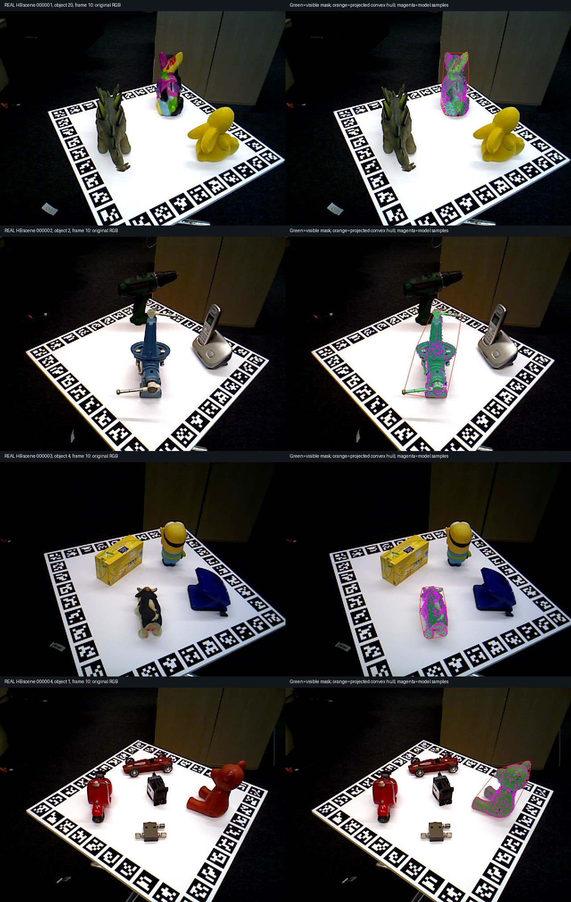

# Independent HB input/protocol sanity audit

**Finding:** no gross millimetre/metre, camera-axis, intrinsics, image-resize, or
model-frame mismatch was found in the sampled scope. This is a bounded source,
geometry and byte-consistency check—not proof that every input is correct, not
independent human accuracy labels, and not a causal diagnosis of the low scores.

The audit was performed separately from authorship of the real-data downloader
and benchmark harness. It uses independent ASCII vertex sampling and explicit
pinhole/backprojection math, without importing their projection/model helpers.
No tracker, neural model, training, or full mesh rendering was run by the audit.

## Scope and input identity

- Frozen public BOP HB `val_primesense` revision
  `985ebaef7b1bd4bffb2039f18dd81faa647fd060`.
- All **3,720** authorized-onboarding/evaluation pose and camera joins checked
  against the original source metadata: twelve object tracks × (10 + 300).
- All **3,600 scored object-frame inference records** contain only the exact
  RGB/calibration/identity/clock whitelist; no scored pose, depth, mask,
  visibility or stress label. Inference/evaluator RGB and calibration joins match.
- Geometry/image inspection: **20 frame samples**, frames 0, 9, 10, 159 and 309 for
  one predeclared first-listed object in **each of all four scenes**: HB objects
  20, 2, 4 and 1. Each model uses at most 4,096 uniformly indexed vertex samples.
- Twelve original metadata hashes, four sampled-model hashes, and all sixty
  sampled RGB/depth/mask hashes match the local pinned acquisition records.
  This is not a second download/hash of the complete upstream archive.
- The entire selected corpus contains **1,240 unique RGB images**, not 3,720
  distinct recordings: three object tracks share each scene's 310 RGB frames.
  Thus 1,200 unique scored RGB images yield 3,600 scored object-frame records.
- Actual saved shared depth-bank asset checked for HB object 20: 600 existing
  anchors, 300 from onboarding view 0 and 300 from view 9. No new bank was built.

[`summary.json`](summary.json) pins the exact script, input/result/asset hashes,
runtime versions and every per-sample numerical result. It contains only public
dataset information, relative paths, and derived measurements—not private model
weights, Drive identifiers or private computer paths.

## Checks and observed values

The [official BOP format](https://github.com/thodan/bop_toolkit/blob/master/docs/bop_datasets_format.md)
specifies model coordinates and translations in millimetres, raw depth multiplied
by `depth_scale` to obtain millimetres, and a right-handed OpenCV camera looking
along +Z. The existing tracker/evaluator's conversion to metres is consistent
with the independently checked samples.

| Check | Observed result |
|---|---|
| Sampled RGB / depth / visible-mask dimensions | All 640×480, no resize |
| Sampled intrinsics | fx 537.4799, fy 536.1447, cx 318.8965, cy 238.3781 |
| Sampled depth scale | 1.0; stored depth values are millimetres |
| Visible-mask pixels inside independently projected model convex hull | 99.7446–99.9565% |
| Sampled model projected bounding box vs original source object bounding box | Maximum coordinate difference ≤2.43 px |
| Front-facing masked model-vertex depth residual, median per sample | 1.68–6.99 mm |
| Those model-depth pairs within 10 mm | 53.04–86.52% |
| Independent real-pixel → object → camera → pixel roundtrip | Maximum 0.000383 px |
| Same model projection in millimetres vs metres | Difference ≤2.28×10⁻¹³ px |
| Saved asset model positions vs independently read source PLY ×0.001 | Exact match |
| 600 checked actual bank anchors projecting inside the proper source visible mask | 100% |
| Checked actual bank anchor depth roundtrip | Maximum 0.0000665 mm |

Roundtrip figures verify implementation consistency, **not physical calibration
accuracy**: roundtrips use the same camera/pose parameters in both directions.
The hull check is containment, **not a silhouette IoU**. Sparse front-facing
vertex depth comparisons have no z-buffer and can include self-occluded/concave
surfaces; they are not a precision depth-sensor validation. Small source-pose,
scan, sensor and discretization errors can remain.

## Original photographed RGB and alignment



Left: actual cached source RGB. Right: the same frame with the provided visible
mask in green, independently projected model convex hull in orange, and sampled
model vertices in magenta. All four rows are frame 10 of their respective scene.
The photos and source byte bindings were inspected; these are **real HB dataset
images**, not the separate synthetic stress corpus. This does not make the
provided pose labels independently human-verified or establish an unseen-data /
pretraining-clean generalization split.

## Interpreting the low coverage

The approximately 2.66% current-system figure is **custom visible-frame accurate
coverage**: the tracker must publish a pose, the source visibility must be ≥0.5,
and mean corresponding-full-model reprojection error must be <5 pixels. It is
**not an official BOP challenge score**, does not quotient object symmetries,
and does not establish physical design-attachment quality.

The frozen current-prototype results contain 10,800 scheduled object-frames
(3,600 × three repeats), with only 453 public poses. Observed nontracking reasons:

| Recorded reason | Frames, including three repeats |
|---|---:|
| `insufficient_correspondences` | 9,324 |
| HB object 33 initialization: `insufficient_onboarding_references` | 900 |
| `pnp_failed` | 90 |
| `insufficient_feature_coverage` | 15 |
| `insufficient_inliers` | 12 |
| `refinement_support_unstable` | 6 |

Most missing outputs therefore occur **before evaluator scoring**. Together with
the sampled geometry checks, this argues against a gross global units/axis bug
as the explanation for low coverage. It does **not** prove whether the dominant
cause is the custom initialization adapter, sparse texture, depth noise,
correspondence rules, viewpoint changes, or another tracker limitation. No cause
is inferred from viewpoint alone.

These results use the **custom shared first-ten masked RGB-D/known-pose depth
bank** with a fixed 300-anchor-per-view budget. That is not the original
rendered-model bank, automatic object discovery/segmentation, GoTrack, or the
complete production pipeline. An original-bank ablation is separate work and
is not replaced by this audit. Using the same adapter for each baseline makes
that particular comparison controlled, not universal.

## Reproduce the lightweight audit

Use Python 3.12 and `bench/requirements-tracking.txt`. The script is portable from
any current directory: defaults resolve from the repository root, and all four
input/output locations can be supplied explicitly. It reads existing corpus,
benchmark-result and service-asset files; it performs **no downloads or model
runs**. If these prerequisites have not been generated, first follow the data,
benchmark and [service-probe instructions](../../tracking-service-probe.md).

```bash
# Existing inputs are the fixed depth-bank benchmark, not the later mesh-bank ablation.
python tools/audit_tracking_hb_protocol.py \
  --dataset .cache/tracking-benchmark/real-v1 \
  --results artifacts/tracking-benchmark/real-full-v1/results.json \
  --asset artifacts/tracking-benchmark/service-probe-v1-assets/dataset-02/object-000020/tracking-asset.npz \
  --output artifacts/tracking-benchmark/hb-protocol-audit-rerun
```

Choose a fresh output directory. The script writes `summary.json` and
`contact-sheet.jpg`, checks its own exact source hash before/after, rejects hash
mismatches/escaping resources, and reads the ordinary public-data NPZ asset with
`allow_pickle=False` and bounded expansion. It never loads a trained checkpoint.
Recorded wall time is diagnostic audit duration, **not tracker throughput**.

Published script SHA256:
`697cc4bd9d67fc21dd5498ca9944248766de8df3874b8197d5b40d7f6188312e`.

## Rights and limits

Underlying RGB, depth, masks, models and reference labels are public BOP HB data
under CC0-1.0. Attribution: Roman Kaskman, Ivan Shugurov, Sergey Zakharov and
Slobodan Ilic (HomebrewedDB, ICCVW 2019), with BOP conversion by the BOP authors.
See the [BOP dataset page](https://bop.felk.cvut.cz/datasets/#HB) and the
[pinned dataset source](https://huggingface.co/datasets/bop-benchmark/hb/tree/985ebaef7b1bd4bffb2039f18dd81faa647fd060).
The derived contact sheet contains those public images and analysis overlays,
not private/user media. Every numerical and methodological limitation is also
preserved in `summary.json`.

## Persisted initialization-bank supplement

A separate [bank geometry/quantity check](bank-comparison.md) compares saved
onboarding-only arrays for HB objects 20 and 28, with independently verified bank
hashes and exact-model nearest-vertex/spread statistics. It reads no scored data
or evaluator labels and makes no causal or fix claim. Its
[small JSON evidence](bank-comparison.json) is separate from this audit's frozen
`summary.json`.
