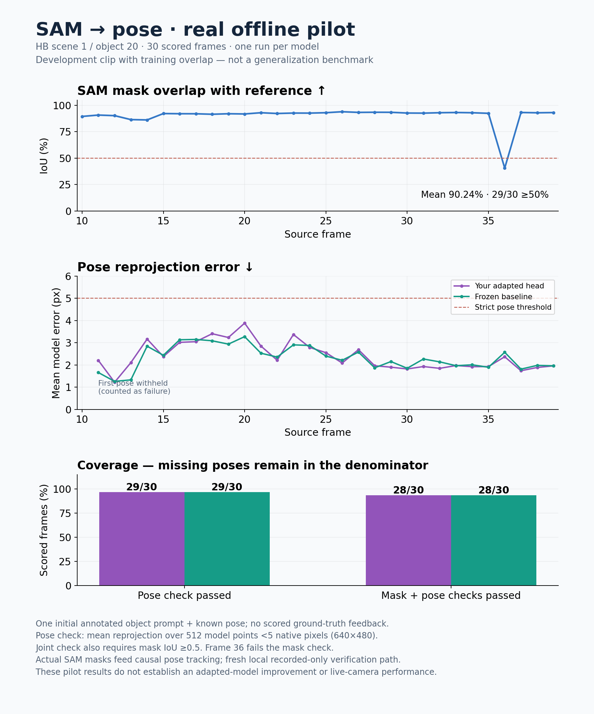

# Actual recorded SAM → pose pilot

**Completed: one real 30-frame development pilot, not the full 12-object suite.**
HB scene 1 / object 20 overlaps the documented training object set, and these
dataset references had already been used by geometric/development evaluations.
The actual inference process received no scored truth or truth feedback.

The project already performed paired full-window model testing on October 21.
This report is a separate fresh-VM dataset benchmark, **not** a claim that the
adapted head had never run on video before. The interrupted new 300-frame
attempt does not erase or replace that historical validation.

## What ran

- Actual SAM 2.1 generated 31 masks from RGB, using only source frame 9's
  annotation-assisted, AI-reviewed positive/negative point prompt.
- The normal native GoTrack pipeline consumed these observed masks and a known
  metric CAD model. Only frame 9 supplied a known pose; source frames 10–39 used
  that seed once, then predicted priors. No scored masks, depth, poses or resets
  entered inference. This is not automatic object discovery or initial pose
  estimation without a supplied seed.
- The adapted primary and frozen upstream baseline ran sequentially on the same
  masks, calibration and inputs: 30 rows and 150 actual full-network forwards
  per role, five refinement iterations per frame. No training occurred.
- This used the explicit fresh-local **recorded-only verification port**, not
  fabricated historical receipts or stock live-serving admission. Normal
  geometry and full-image reference/export parity checks passed; model
  arithmetic was unchanged. The historical default and live restrictions remain.

## Dataset-reference results

| Metric | Adapted primary | Frozen baseline |
|---|---:|---:|
| Public poses / all scheduled frames | 29/30 | 29/30 |
| Mean-model reprojection strictly <5 native px / all frames | 29/30 | 29/30 |
| Mask IoU ≥0.5 **and** pose <5 px / all frames | 28/30 | 28/30 |
| Public-only reprojection P50 / P95, px | 2.204 / 3.391 | 2.267 / 3.142 |
| Public-only ADD P50 / P95, mm | 20.689 / 27.447 | 20.009 / 28.057 |
| Public-only rotation P50 / P95, degrees | 4.804 / 10.152 | 3.259 / 9.139 |
| Public-only translation P50 / P95, mm | 17.775 / 25.929 | 17.776 / 26.821 |

Shared SAM mean IoU is **0.902433**, with 29/30 masks at IoU ≥0.5. Frame 36 is
the exception (IoU 0.405649), despite high reference visibility; both pose
outputs remain below the 2D threshold. Frame 10's initial temporal-check output
is withheld in both roles and **remains a failure in the 30-frame coverage
denominator**, not a zero-error success. All 30 reference frames are visible
at the configured visibility ≥0.5 threshold; absent-object behavior is untested.

**Interpretation:** the real observed-mask → trained-pose path functions on this
short initialized clip. It does **not** show a clear adapted-model advantage:
threshold coverage ties, the primary's median projection is slightly lower,
but its projection tail and rotation errors are worse. Nor is 29/30 a generic
96.7% 3D-accuracy claim: conditional ADD is about 2 cm. An independent
translation decomposition found most translation-error energy along camera Z;
good 2D alignment does not by itself establish accurate depth or attachment.

Errors use 512 deterministic original-model vertex indices, native 640×480 K,
metre translations and unchanged source-object axes. They are corresponding-point
proxies, **not** full-mesh/symmetry-aware official BOP scores or independent human
attachment labels. Six rows × five metrics were independently recomputed with
zero scalar difference; original reference matrices and sampled PLY/GLB points
were crosschecked. Rounded references use the existing native 1e-4 rotation
tolerance, predictions face a 1e-6 audit, and no rotation is repaired.

## Timing is staged, not a live-stream latency benchmark

One repeat, no warm-up; shared 9-logical-CPU AMD EPYC VM, Torch 8 threads,
OpenCV/OpenBLAS 1, CPU only. Both roles share the one actual SAM job.

| Measurement | Observed value |
|---|---:|
| SAM job, 31 input masks | 120.722 s |
| SAM initialization | 3.620 s |
| Scored SAM frame P50 / P95 | 3.892 / 4.336 s |
| Primary cached-mask pose frame P50 / P95 | 6.445 / 7.077 s |
| Baseline cached-mask pose frame P50 / P95 | 5.927 / 6.539 s |
| Native two-role run wall | 390.729 s |
| Supervised two-role pose job wall | 397.250 s |
| Separate SAM + both-role job walls combined | 517.972 s |

Pose-frame times include native decode/mask/boundary/refinement work but exclude
SAM and model initialization. Matching-frame SAM-plus-pose sums are in JSON;
they are sums of separately measured stages, **not measured integrated streaming
latency**. No physical FPS is invented for the frame-index source. Native peak
pose-process memory was 3,150,008,320 bytes; this was not a dedicated-hardware
speed study or phone/GPU benchmark.

The first recovering output still performs refinements. After a true hard
solver/mask loss, this backend has **no automatic reacquisition**; later cheap
state-only failures must not be described as faster successful inference. No
such hard-loss recovery event was exercised here. Artwork was unavailable due
the unchanged 200,000-face artwork cap; metric pose output is not a rendered
frontend test.

## Separate full-sequence attempt

A later full clip produced **301 actual SAM masks** in 1,184.301 seconds, with
all 31 pilot-prefix PNGs byte-identical. Its subsequent paired 300-frame pose
attempt lost the execution-service session before native results/report and
supervision completion were written. **There is no full-300 or biased partial
quality score.** Orphan termination could not be verified through the available
session controls, so no duplicate job or GPU-lock deletion was attempted.
This infrastructure incident is not a measured model/solver failure.

## Reproduction and evidence

- [Complete recorded setup/run/seal/score order](../../tracking-offline-benchmark.md).
- [Dataset card](../../../datasets/offline-sam-pose-v1/README.md) and
  [licensed full media](https://github.com/joeyhlu/visualizeIT/releases/tag/tracking-dataset-v1).
- `summary.json`: sanitized measurements, public source/data identities and
  runtime versions; no private model file, raw configuration, receipt or path.
- `pose-frames.csv` and `segmentation-frames.csv`: exact finalized metric rows.
  Missing pose errors are blank, not zeros; join by source frame and role.

The pilot source/evaluation snapshots remain frozen. Its historical seal's
truth-isolation statement is explicitly **run-local**, not a claim that the
dataset labels had never been opened. Future expanded runs use an explicit
reused-reference development protocol. No main merge, deployment, paid compute,
training, or full-suite completion is implied.
