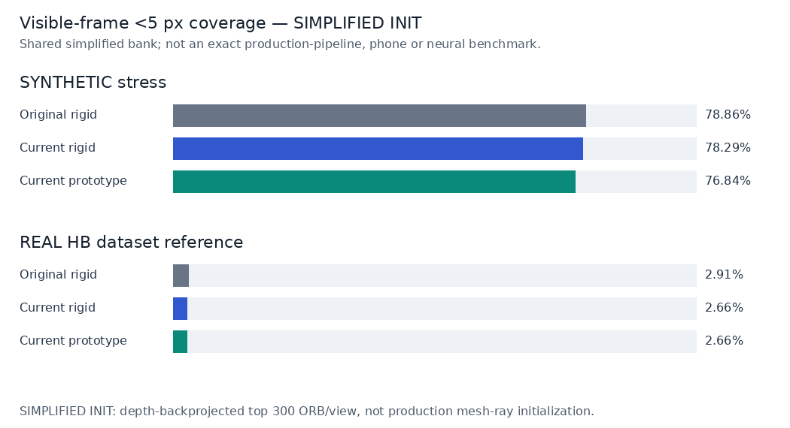
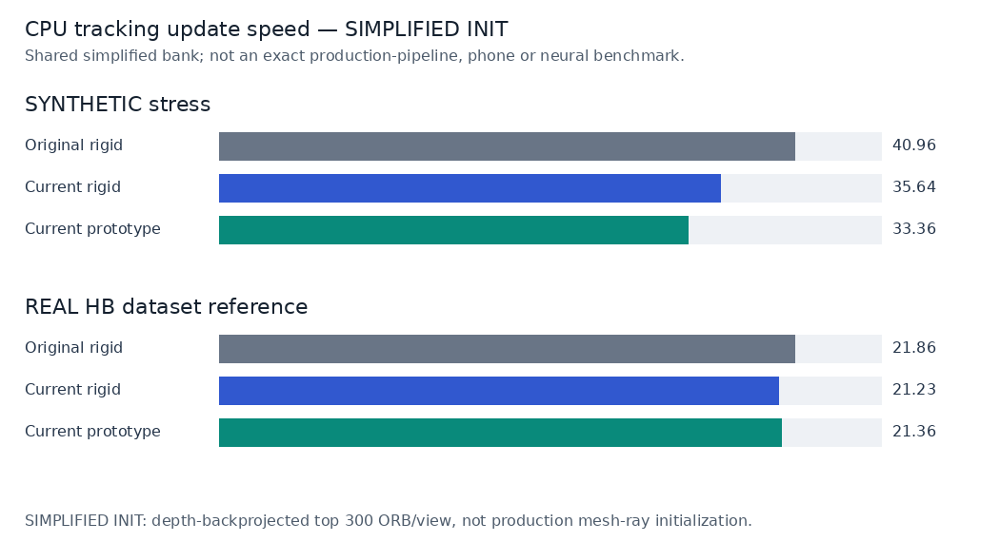

# Shared simplified-initialization tracking experiment — 2026-10-26

## Scope and measured comparison

**Follow-up:** the separately sealed [full real-corpus production-initialization
run](tracking-real-production-v3/README.md) is now available. It remains a
geometric component test, not SAM or the trained pose network. The immutable
tables below retain their original simplified protocol and three repeats.

**These full-corpus results use SHARED SIMPLIFIED INITIALIZATION, not the exact full production pipeline.** The adapter backprojects authorized masked RGB-D using known onboarding poses and keeps only the first 300 ORB features per view (at most 3,000 anchors). The production bank instead uses mesh-ray surface intersections and all detected features up to its configured 2,000 per view. A common simplified bank controls the comparison but may materially change absolute quality and the relative ranking; do not generalize this experiment to the unmeasured full-production initialization.

This is **initialized RGB rigid tracking**, not automatic object discovery, independent physical-attachment accuracy, or phone/live-camera performance. Real HB footage and explicitly synthetic stress tests are reported separately. All three systems receive the same simplified immutable bank from ten authorized masked RGB-D/pose onboarding frames; scored updates receive RGB and calibration only.

**Initialization sensitivity is confirmed by the separately sealed prefix diagnostic below.** Its limited production-mesh results must not replace or be extrapolated into the immutable simplified full-corpus tables; a full-corpus production-initialization comparison is not reported here.

**Main finding under the simplified bank:** real HB native-5-pixel visible coverage is only 2.91% for the original and 2.66% for the current wrapper. This does not establish reliable real-world tracking, but it is also **not a measured verdict on the full-production bank**. On synthetic footage, the current code exposes fewer wrong-threshold poses but also withholds usable outputs; the paired analysis below separates those effects.

Complete licensed real and synthetic media, annotation packs and checksums are published in the [tracking dataset prerelease](https://github.com/joeyhlu/visualizeIT/releases/tag/tracking-dataset-v1) (release target `c10cb8b0dd464b5f12e892c0f2c277569ae872be`). The small committed recipe/examples are not the full media corpus.

## Separate paired initialization diagnostic — limited real prefix

The first 3 HB objects (20, 28, 33) use the same RGB/model/calibration/frame subset: 330 scheduled object-frames, 330 reference-visible, 1 repeat, and identical source/configuration except initialization policy. These rows are **not pooled into** the full-corpus tables.

| Bank / tracker | Qualified <5 px / visible frames | Wrong-threshold visible public poses | Public / all frames | Init failures | Skipped updates |
|---|---:|---:|---:|---:|---:|
| simplified / Current prototype | 19/330 (5.76%) | 5 | 24/330 | 1 | 110 |
| simplified / Current rigid | 19/330 (5.76%) | 5 | 24/330 | 1 | 110 |
| simplified / Original rigid | 23/330 (6.97%) | 18 | 41/330 | 1 | 110 |
| production_mesh / Current prototype | 36/330 (10.91%) | 0 | 36/330 | 0 | 0 |
| production_mesh / Current rigid | 36/330 (10.91%) | 0 | 36/330 | 0 | 0 |
| production_mesh / Original rigid | 37/330 (11.21%) | 24 | 61/330 | 0 | 0 |

The production mesh-ray bank materially changes this prefix: it removes the shared initialization failure and changes coverage. This confirms that the earlier simplified percentages cannot be presented as full-production-pipeline quality. It does **not** establish performance on the remaining objects, later frames, other datasets, or neural tracking.

The adapters change both point geometry and the feature cap; this is not an isolated causal test of either detail. Production setup is substantially more expensive and is excluded from update FPS. Per-object bank evidence:

| Bank | Object | Anchors | Initialization seconds | Failure |
|---|---:|---:|---:|---|
| simplified | 20 | 3000 | 0.94 | none |
| simplified | 28 | 1016 | 1.45 | none |
| simplified | 33 | — | — | ValueError: insufficient_onboarding_references |
| production_mesh | 20 | 1893 | 153.60 | none |
| production_mesh | 28 | 1085 | 228.54 | none |
| production_mesh | 33 | 161 | 124.39 | none |

[Initialization-prefix CSV](tracking-initialization-prefix-2026-10-26.csv); full provenance, paired-output accounting, trace hashes and bank metadata are in aggregate JSON. Both prefix inference seals and all raw predictions were checked before reading their scored output.

## Full-corpus shared simplified-initialization results

### Synthetic stress corpus

24 sequences; 4,560 unique scheduled object-frames; 4,257 reference-visible object-frames (visibility ≥0.5). Metrics pool all repeats; unique counts do not multiply repeated observations.

| System | <5 px visible coverage | Public pose / all frames | Public pose / visible frames | Update FPS | Replay FPS | Init failures / sequences | Skipped updates |
|---|---:|---:|---:|---:|---:|---:|---:|
| Original rigid | 78.86% | 76.58% | 80.17% | 40.96 | 38.88 | 3/24 | 1,710/13,680 |
| Current rigid | 78.29% | 75.55% | 78.95% | 35.64 | 34.01 | 3/24 | 1,710/13,680 |
| Current prototype | 76.84% | 74.12% | 77.43% | 33.36 | 31.92 | 3/24 | 1,710/13,680 |

Relative to the exact original tracker:
- **Current rigid:** -0.56 percentage-point change in native-5-pixel visible coverage; 0.87× attempted-update throughput. A stricter public-pose policy may lower availability; speed is not a quality score.
- **Current prototype:** -2.02 percentage-point change in native-5-pixel visible coverage; 0.81× attempted-update throughput. A stricter public-pose policy may lower availability; speed is not a quality score.

**Conditional pose errors — public outputs only.** These exclude lost/uninitialized frames; read them together with coverage above, not as unconditional accuracy.

| System | Public frame samples | Mean-model reprojection px P50 / P95 | ADD m P50 / P95 | Rotation ° P50 / P95 | Translation m P50 / P95 |
|---|---:|---:|---:|---:|---:|
| Original rigid | 10,476 | 0.86 / 3.62 | 0.0028 / 0.0103 | 0.84 / 4.19 | 0.0023 / 0.0092 |
| Current rigid | 10,335 | 0.84 / 3.10 | 0.0027 / 0.0103 | 0.84 / 3.36 | 0.0022 / 0.0096 |
| Current prototype | 10,140 | 0.85 / 3.10 | 0.0027 / 0.0103 | 0.85 / 3.36 | 0.0022 / 0.0094 |

| System | Recovery events / recovered / failed | Successful recovery delay P50 / P95, observable frames | Longest public loss run | Longest visible <5 px coverage gap | Hidden public poses |
|---|---:|---:|---:|---:|---:|
| Original rigid | 27 / 21 / 6 | 4.0 / 20.0 | 190 | 190 | 0 |
| Current rigid | 27 / 21 / 6 | 4.0 / 20.0 | 190 | 190 | 0 |
| Current prototype | 27 / 21 / 6 | 21.0 / 41.0 | 190 | 190 | 0 |

Recovery starts only after a reference visibility-zero interval; success needs two consecutive visible public outputs below 5 px before another hidden interval. Events above include repeats. No observed event means **not tested**, not perfect recovery.

### Real HB validation corpus

12 sequences; 3,600 unique scheduled object-frames; 3,536 reference-visible object-frames (visibility ≥0.5). Metrics pool all repeats; unique counts do not multiply repeated observations.

| System | <5 px visible coverage | Public pose / all frames | Public pose / visible frames | Update FPS | Replay FPS | Init failures / sequences | Skipped updates |
|---|---:|---:|---:|---:|---:|---:|---:|
| Original rigid | 2.91% | 5.22% | 5.32% | 21.86 | 19.48 | 1/12 | 900/10,800 |
| Current rigid | 2.66% | 4.19% | 4.27% | 21.23 | 18.99 | 1/12 | 900/10,800 |
| Current prototype | 2.66% | 4.19% | 4.27% | 21.36 | 19.12 | 1/12 | 900/10,800 |

Relative to the exact original tracker:
- **Current rigid:** -0.25 percentage-point change in native-5-pixel visible coverage; 0.97× attempted-update throughput. A stricter public-pose policy may lower availability; speed is not a quality score.
- **Current prototype:** -0.25 percentage-point change in native-5-pixel visible coverage; 0.98× attempted-update throughput. A stricter public-pose policy may lower availability; speed is not a quality score.

**Conditional pose errors — public outputs only.** These exclude lost/uninitialized frames; read them together with coverage above, not as unconditional accuracy.

| System | Public frame samples | Mean-model reprojection px P50 / P95 | ADD m P50 / P95 | Rotation ° P50 / P95 | Translation m P50 / P95 |
|---|---:|---:|---:|---:|---:|
| Original rigid | 564 | 4.09 / 8.40 | 0.0202 / 0.0683 | 6.32 / 69.26 | 0.0190 / 0.0723 |
| Current rigid | 453 | 2.75 / 8.95 | 0.0134 / 0.0787 | 4.97 / 72.12 | 0.0122 / 0.0774 |
| Current prototype | 453 | 2.75 / 8.95 | 0.0134 / 0.0787 | 4.97 / 72.12 | 0.0122 / 0.0774 |

| System | Recovery events / recovered / failed | Successful recovery delay P50 / P95, observable frames | Longest public loss run | Longest visible <5 px coverage gap | Hidden public poses |
|---|---:|---:|---:|---:|---:|
| Original rigid | 0 / 0 / 0 | — / — | 300 | 298 | 0 |
| Current rigid | 0 / 0 / 0 | — / — | 300 | 298 | 0 |
| Current prototype | 0 / 0 / 0 | — / — | 300 | 298 | 0 |

Recovery starts only after a reference visibility-zero interval; success needs two consecutive visible public outputs below 5 px before another hidden interval. Events above include repeats. No observed event means **not tested**, not perfect recovery.

## Under simplified initialization, is the current code simply worse?

A smaller error among accepted poses can coexist with **fewer usable poses overall**. The table below isolates that tradeoff on repeat 0 only (unique paired object-frames, not repeat-multiplied counts). ‘Wrong’ is shorthand for a public pose on a reference-visible frame at **≥5 px mean-model reprojection error**—an error-threshold proxy, **not** a human-verified attachment or detector false positive.

| Corpus / baseline → candidate | Qualified visible outputs | Wrong-threshold visible outputs | Both-public subset / P95 px baseline → candidate | Net qualified outputs |
|---|---:|---:|---:|---:|
| synthetic / Original rigid → Current rigid | 3,357 → 3,333 | 56 → 28 | 3,355 / 3.36 → 2.99 | -24 |
| synthetic / Original rigid → Current prototype | 3,357 → 3,271 | 56 → 25 | 3,290 / 3.32 → 2.99 | -86 |
| synthetic / Current rigid → Current prototype | 3,333 → 3,271 | 28 → 25 | 3,296 / 3.01 → 3.01 | -62 |
| real / Original rigid → Current rigid | 103 → 94 | 85 → 57 | 149 / 8.15 → 8.83 | -9 |
| real / Original rigid → Current prototype | 103 → 94 | 85 → 57 | 149 / 8.15 → 8.83 | -9 |
| real / Current rigid → Current prototype | 94 → 94 | 57 → 57 | 151 / 8.80 → 8.80 | +0 |

| Corpus / baseline → candidate | Baseline-qualified outputs withheld | Baseline-wrong outputs withheld | New qualified / wrong outputs where baseline withheld | Net qualified change within shared public subset |
|---|---:|---:|---:|---:|
| synthetic / Original rigid → Current rigid | 53 | 5 | 0 / 6 | +29 |
| synthetic / Original rigid → Current prototype | 114 | 9 | 0 / 6 | +28 |
| synthetic / Current rigid → Current prototype | 62 | 3 | 0 / 0 | +0 |
| real / Original rigid → Current rigid | 13 | 26 | 2 / 0 | +2 |
| real / Original rigid → Current prototype | 13 | 26 | 2 / 0 | +2 |
| real / Current rigid → Current prototype | 0 | 0 | 0 / 0 | +0 |

- **synthetic, wrapper versus original:** -86 qualified visible outputs overall. Within their 3,290 mutually public visible frames, qualified outputs change by +28; this shared-output comparison excludes the 114 baseline-qualified frames that the wrapper withholds. It also exposes 6 wrong-threshold frames where the original withheld. Lower accepted-only error is therefore not proof of better whole-stream utility.
  - Largest observed successful-recovery slowdown: `SYNTHETIC train-full_occlusion-27686`, return frame 97: original 4 → wrapper 41 observable frames (requires two consecutive qualified outputs).
- **synthetic, additional wrapper policy versus current rigid:** -3 wrong-threshold visible outputs and -62 qualified outputs. This is a measurable safety/availability tradeoff, not evidence that the whole current implementation is useless or universally superior.
- **real, wrapper versus original:** -9 qualified visible outputs overall. Within their 149 mutually public visible frames, qualified outputs change by +2; this shared-output comparison excludes the 13 baseline-qualified frames that the wrapper withholds. It also exposes 0 wrong-threshold frames where the original withheld. Lower accepted-only error is therefore not proof of better whole-stream utility.
  - On this real shared-public subset, the P95 tail changes from 8.15 to 8.83 px; it does **not** reproduce the synthetic tail-error improvement. The current rigid and wrapper have the same measured public-pose coverage/error counts here; that does not imply all diagnostic states are byte-identical.
- **real, additional wrapper policy versus current rigid:** +0 wrong-threshold visible outputs and +0 qualified outputs. This is a measurable safety/availability tradeoff, not evidence that the whole current implementation is useless or universally superior.

The preferred operating point depends on the application cost of a wrong exposed pose versus an unavailable overlay; no independent human utility or physical-attachment assessment was performed. Fully hidden public-pose counts are reported separately above and are not inferred from this visible-frame proxy.

## Synthetic stress slices

Scenario names are parsed from the exact generator sequence identity (not missing `tags` metadata). Train/dev/test seed groups remain separately identifiable in the CSV; this benchmark fits no new tracker parameters.

| Scenario | Original rigid <5 px | Current rigid <5 px | Current prototype <5 px |
|---|---:|---:|---:|
| smooth | 100.00% | 100.00% | 100.00% |
| fast_motion | 100.00% | 99.47% | 98.95% |
| motion_blur | 96.49% | 94.91% | 94.91% |
| illumination | 100.00% | 100.00% | 100.00% |
| partial_occlusion | 67.48% | 62.78% | 61.15% |
| full_occlusion | 80.92% | 81.13% | 72.54% |
| exit_reentry | 86.39% | 88.66% | 86.39% |
| low_texture | 0.00% | 0.00% | 0.00% |

## Repeat stability and failures

Timing-free digests compare exact frame/state/reason/pose values, excluding clocks, session IDs, timing and internal diagnostics. These are repeated executions of the same footage, not independent data samples or confidence intervals.

| Corpus / system | Identical sequence groups | Changed frame comparisons | Repeat coverage range | Repeat update FPS range |
|---|---:|---:|---:|---:|
| synthetic / Original rigid | 24/24 | 0/9,120 | 78.86%–78.86% | 40.58–41.19 |
| synthetic / Current rigid | 24/24 | 0/9,120 | 78.29%–78.29% | 35.62–35.66 |
| synthetic / Current prototype | 24/24 | 0/9,120 | 76.84%–76.84% | 33.10–33.82 |
| real / Original rigid | 12/12 | 0/7,200 | 2.91%–2.91% | 21.67–22.13 |
| real / Current rigid | 12/12 | 0/7,200 | 2.66%–2.66% | 21.08–21.47 |
| real / Current prototype | 12/12 | 0/7,200 | 2.66%–2.66% | 21.13–21.53 |

Most frequent withheld-output reasons (all repeats; not silently dropped):
- synthetic / Original rigid: `ValueError: insufficient_onboarding_references`: 1,710; `insufficient_correspondences`: 1,461; `insufficient_feature_coverage`: 18.
- synthetic / Current rigid: `ValueError: insufficient_onboarding_references`: 1,710; `insufficient_correspondences`: 1,593; `insufficient_feature_coverage`: 18.
- synthetic / Current prototype: `ValueError: insufficient_onboarding_references`: 1,710; `insufficient_correspondences`: 1,689; `awaiting_recovery_consensus`: 69.
- real / Original rigid: `insufficient_correspondences`: 9,216; `ValueError: insufficient_onboarding_references`: 900; `pnp_failed`: 90.
- real / Current rigid: `insufficient_correspondences`: 9,324; `ValueError: insufficient_onboarding_references`: 900; `pnp_failed`: 90.
- real / Current prototype: `insufficient_correspondences`: 9,324; `ValueError: insufficient_onboarding_references`: 900; `pnp_failed`: 90.

## Reproduction and boundaries

- Native `<5 px` coverage is the fraction of reference-visible frames with a public pose whose **mean corresponding-model-point reprojection error** is strictly below 5 input pixels. It is not a landmark attachment tolerance, human-annotated accuracy, detector accuracy, or an official BOP score.
- Evaluation uses the same deterministic geometry-only sample of at most 512 source-model vertices per object. ADD is mean corresponding-point distance in metres; rotation/translation are pose errors. Symmetries are **not** matched, and dataset-reference poses can contain error.
- Attempted-update FPS = timed calls / summed update time. Replay FPS additionally includes RGB decode/hash and loop overhead for trials with attempted updates. Both exclude onboarding, disposable warmup, evaluation, rendering and export. Setup/initialization failures keep scheduled-frame denominators but are excluded from speed numerators; skipped updates are reported explicitly.
- Original means the exact repository historical **update implementation**, loaded from `git show`, not a reimplementation. Current rigid and current prototype also preserve their production update methods. **All three initialization paths are replaced by the shared simplified adapter**; this is not a full-production-pipeline comparison.
- **Neural GoTrack/adapted-head tracking quality is not measured by these tables.** A separate finite model diagnostic is described below; execution/parity is not video-tracking quality or serving admission.
- Synthetic images are not real evidence. Real HB is a previously used project dataset, with unknown pretrained exposure; these clips do not demonstrate unseen-object generalization. Full RGB/depth/mask/model media are acquired from the pinned CC0 source or the published dataset release; committed real examples and complete annotation packs are a subset/different representation, not the complete media archive.

### Frozen benchmark source versus later publication/report commits

The full-run harness last changed in commit `c9acdaa5c3e72b8ff1d1a3ee76cd8a90784d9583` and is snapshotted from `c10cb8b0dd464b5f12e892c0f2c277569ae872be`; its frozen SHA-256 is `3a187e7594707f1a41736ad273cf06020238cf01750387ee5b55e6c1571127e5`. Both corpora match that source anchor: `True`. The current checkout matches the old harness: `False`; later initialization-ablation code must not be mistaken for what ran in these full results. The report was generated from working-tree base `7552f8c947c15746208edcab96bbfceb8d8b8fc2`. Source hashes in each inference seal, not the eventual PR head, identify what actually ran; report/source snapshots are hashed separately.

### Separate trained-model execution diagnostic (not tracking quality)

The [finite CPU neural diagnostic](tracking-neural-cpu-v1/README.md) completed 30 full-network forwards in 147.77 seconds, with 2.93 GiB peak sampled process-group RSS. Saved-reference versus trained-export numerical parity: `True`. It used two authorized onboarding queries with known seed poses/masks and contributes **0 new scored video-tracking frames**. Workbench admission granted: `False`. It is an execution/parity check, not evidence of better tracking, independent attachment accuracy or live/neural FPS.

### synthetic runtime and seals

- Hardware: AMD EPYC 9V74 80-Core Processor; 9 logical CPUs; RAM `10206484 kB`; GPU used: `False`; OpenCV threads: `1`.
- Versions: Python `3.12.14 (main, Aug 25 2026, 14:00:49) [Clang 22.1.3 ]`; NumPy `2.3.5`; OpenCV `4.13.0`; Pillow `12.3.0`. Platform: `Linux-6.18.55-x86_64-with-glibc2.41`.
- Protocol: 3 full repeats; 20 disposable warmup frames per sequence/system/repeat; serial systems/sequences. Initialization: ten annotated masked RGB-D frames; ORB depth-backprojected immutable bank; first 300 detector features per view, <=3000 anchors.
- Original commit: `df788084e1e0eb79950fe81cf87b603044c1a2d5`; original tracker SHA-256: `0d619def904edaf68ffb35e2bedee45b1dcafdb3d2053a4af59be7d40a5d89d1`.

| Artifact | SHA-256 |
|---|---|
| Inference manifest | `248b084ed6224b25f051a28c0db6c4d4f64ffed7c0740c65b02f47266a2ba989` |
| Evaluator manifest | `bcc998e540cd9360dd1901982e28d4431daab0affdc7f5e679e0fc0b400e4cb8` |
| Inference seal | `5de3bbbe2530db856b60d6a1473b519a656b088df366e78f146481c14bfebe3c` |
| Results | `9e25460e676c0949a82e76f4b8759709fb6a605d174a2b1492c8f4485147fd95` |

### real runtime and seals

- Hardware: AMD EPYC 9V74 80-Core Processor; 9 logical CPUs; RAM `10206484 kB`; GPU used: `False`; OpenCV threads: `1`.
- Versions: Python `3.12.14 (main, Aug 25 2026, 14:00:49) [Clang 22.1.3 ]`; NumPy `2.3.5`; OpenCV `4.13.0`; Pillow `12.3.0`. Platform: `Linux-6.18.55-x86_64-with-glibc2.41`.
- Protocol: 3 full repeats; 20 disposable warmup frames per sequence/system/repeat; serial systems/sequences. Initialization: ten annotated masked RGB-D frames; ORB depth-backprojected immutable bank; first 300 detector features per view, <=3000 anchors.
- Original commit: `df788084e1e0eb79950fe81cf87b603044c1a2d5`; original tracker SHA-256: `0d619def904edaf68ffb35e2bedee45b1dcafdb3d2053a4af59be7d40a5d89d1`.

| Artifact | SHA-256 |
|---|---|
| Inference manifest | `1bdc84f5865797c308c2a46dad67c90f532ecb3e963ac5713b80acd820831af4` |
| Evaluator manifest | `1fc8fe971bf000c244b35d8416d473684f826fe756ae91dea2e2a41b861d9956` |
| Inference seal | `79af25836a0f2b11cbccc6bd6a9a1c897389b7ef7459726e03d084a8d700f0dc` |
| Results | `df33d4f746a0897aedc0dcbfb62609f89b44a8afb9f730cbe0c312fa380e69f6` |

## Compact artifacts

- [Aggregate JSON](tracking-aggregate-2026-10-26.json) — pooled metrics, repeat variation, hardware, versions and source/data hashes.
- [Aggregate CSV](tracking-aggregate-2026-10-26.csv); [per-sequence/repeat CSV](tracking-sequences-2026-10-26.csv); [stress-slice CSV](tracking-stress-2026-10-26.csv).
- [Paired-output tradeoff CSV](tracking-paired-2026-10-26.csv) — unique repeat-0 shared-output and abstention accounting.
- [Trace hash index](tracking-trace-index-2026-10-26.json) — exact hashes of local raw/scored traces, without committing all bulky trace files.

Shared-VM timings are descriptive of this run, not dedicated-hardware latency guarantees. No merge, deployment, physical-phone test, paid compute, or new model training is implied.
